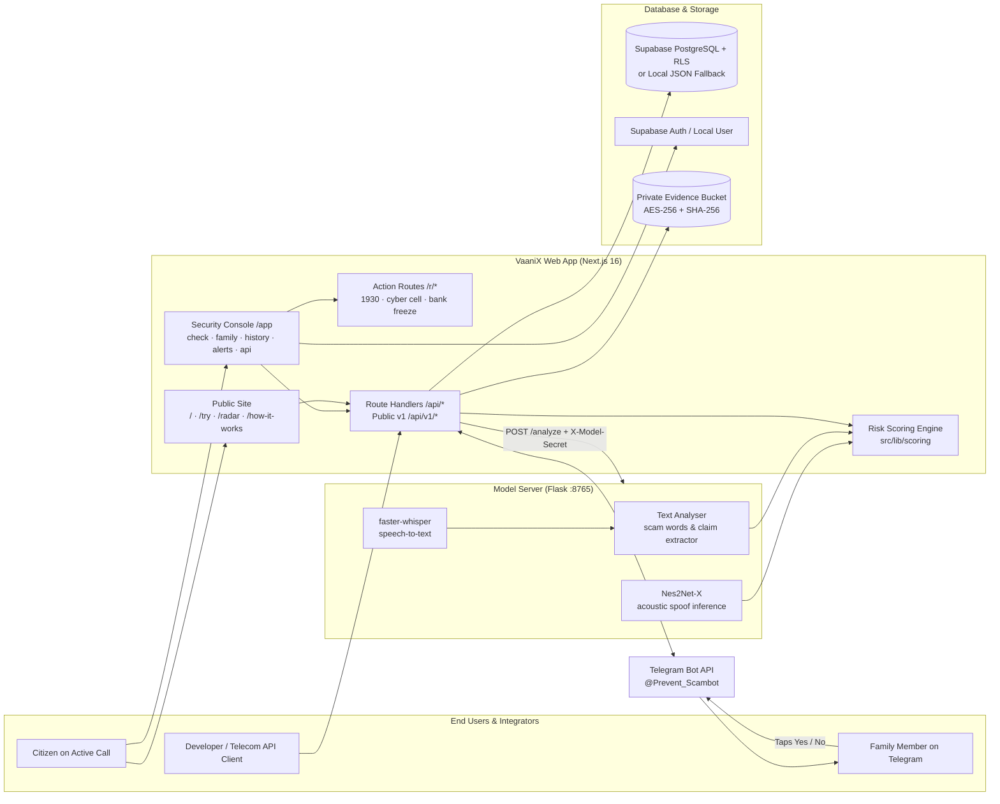
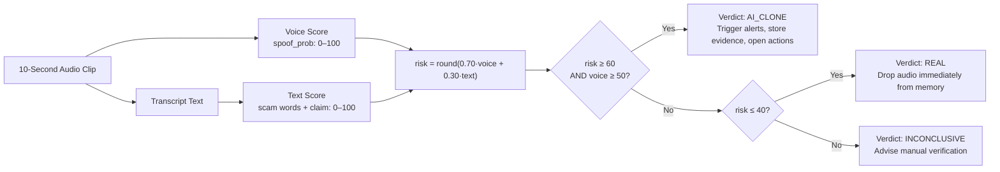

<!-- prettier-ignore -->
<div align="center">

# VaaniX

**Catch AI voice-clone scam calls while they are still ringing, and warn the family before the money moves.**

[](https://52.62.8.151.sslip.io)
[](https://52.62.8.151.sslip.io/try)

[](https://github.com/vandit-bajaj/VaaniX/actions/workflows/ci.yml)
[](https://nextjs.org/)
[](https://react.dev/)
[](https://www.typescriptlang.org/)
[](https://pytorch.org/)
[](https://supabase.com/)
[](https://aws.amazon.com/)
[](https://core.telegram.org/bots/api)
[](https://vitest.dev/)
[](LICENSE)

[About VaaniX](#-about-vaanix) • [Features](#-features) • [How It Works](#-how-it-works) • [Architecture](#-system-architecture) • [Getting Started](#-getting-started) • [Deploying to AWS](#-deploying-to-aws) • [Status & Transparency](#-status-and-transparency) • [Privacy](#-privacy-and-security)

</div>

---

> [!TIP]
> **Live Deployment:** [52.62.8.151.sslip.io](https://52.62.8.151.sslip.io)  
> You can test the platform live right now. Click **Open App** from the homepage to explore the console (with automated local store mode, no sign-up required), or upload a test clip on [`/try`](https://52.62.8.151.sslip.io/try).

| 🎙️ 10-Second Acoustic Check | 👨‍👩‍👧 Family Verification | 📡 Community Scam Radar | 🚨 Golden-Hour Action |
|:---:|:---:|:---:|:---:|
| Dual-engine Nes2Net-X acoustic spoof score + Hindi/Hinglish extortion language parsing | Out-of-band Telegram query to the real family member with one-tap confirmation | Real-time crowd-sourced reputation engine for suspect phone numbers | Instant 1930 speed-dial, state cyber-cell complaint draft, and bank freeze request |

---

## 🛡️ About VaaniX

### The Problem: Voice Cloning Weaponizes Family Trust

Artificial Intelligence has made voice impersonation cheap, rapid, and devastating. Using as little as 3 seconds of raw audio harvested from a social media story, video reel, or public voicemail, malicious actors generate convincing synthetic replicas of a target's voice.

In India and across the globe, organized fraud syndicates weaponize these clones to target parents, spouses, and elderly citizens with high-pressure emergency scenarios:
- *"Papa, please transfer ₹50,000 urgently to this UPI ID — police have detained me after a vehicle collision."*
- *"Ma'am, this is Cyber Cell Inspector Sharma. Your Aadhaar is tied to illegal transactions; you must verify your identity immediately."*

Because the caller **sounds unmistakably like their loved one**, victims enter a state of acute panic. They transfer funds via instant UPI or IMPS within minutes — before having the chance to step back, cross-examine, or dial their child directly. By the time they discover the deception, the stolen money has already bounced through layered mule accounts and been withdrawn at ATMs.

### Verified Scale & Impact

Every figure and metric referenced throughout VaaniX comes exclusively from verified parliamentary replies, threat intelligence reports, and peer-reviewed academic literature:

| Metric | Verified Real-World Finding | Official Citation |
|:---|:---|:---|
| **47%** | Of Indian adults have personally faced or know someone targeted by an AI voice scam *(vs. 25% globally)* | McAfee *Beware the Artificial Impostor* Survey ([Digital Terminal](https://digitalterminal.in/tech-companies/mcafee-reveals-47-of-indians-have-faced-ai-voice-scams)) |
| **83%** | Of Indian voice scam victims suffered immediate financial loss; nearly half lost over ₹50,000 | McAfee Threat Research ([BOOM Live Report](https://www.boomlive.in/explainers/ai-voice-scam-voice-cloning-mcafee-report-21851)) |
| **3 Seconds** | Of audio was sufficient to generate an 85% voice clone match in empirical laboratory tests | McAfee Threat Research Labs ([Report](https://digitalterminal.in/tech-companies/mcafee-reveals-47-of-indians-have-faced-ai-voice-scams)) |
| **₹22,845 Cr** | Lost by Indian citizens to cyber fraud in 2024 *(a 206% surge from ₹7,465 Cr in 2023)* | Lok Sabha Parliamentary Reply, Ministry of Home Affairs, July 22, 2025 ([Scroll](https://scroll.in/latest/1084796/indians-lost-rs-22845-crore-to-cyber-fraud-in-2024-a-206-rise-from-previous-year-centre)) |
| **27%** | Of deepfake speech samples were completely missed by human listeners in a 529-participant controlled trial, even after training | University College London (UCL), *PLOS ONE*, Aug 2023 ([UCL News](https://www.ucl.ac.uk/news/2023/aug/humans-unable-detect-over-quarter-deepfake-speech-samples)) |

### The Defense Philosophy: Intercept Before the Money Moves

Traditional fraud response is entirely forensic and retroactive: victims file a police complaint days after funds are irreversibly gone. 

VaaniX changes the paradigm from **post-loss regret** to **in-call interception**:
1. **Listen to the acoustic signatures:** Synthetic voices leave subtle artifacts in pitch, spectral phase, and vocoder synthesis that neural models detect even when human ears fail.
2. **Consult the family out-of-band:** The single most reliable indicator that an incoming call is fraudulent is the real family member saying *"I never called"*. VaaniX routes a high-priority Telegram message to the real person's phone in parallel.
3. **Act in the golden hour:** The first 60 minutes after an attempted transfer are critical. VaaniX gives users immediate speed-dialing to the National Cyber Crime Helpline (**1930**), pre-fills compliant state cyber-cell emails with cryptographic SHA-256 evidence digests, and notifies banks to freeze suspect transactions.

---

## ✨ Features

| Feature | How It Operates |
|:---|:---|
| **10-Second Acoustic Check** | Captures a 10-second sample of the incoming call. Runs **Nes2Net-X** (wav2vec 2.0 XLSR-53 front-end with 300M parameters) to compute acoustic spoof probability ($0 \to 100$). Concurrently runs **faster-whisper** with Indic transliteration to match Hindi, Hinglish, and English extortion vocabularies (arrest, bail, hospital, OTP, customs). |
| **Transparent Risk Fusion** | Combines signals arithmetically: $\text{risk} = \text{round}(0.70 \times \text{voice} + 0.30 \times \text{text})$. A call is classified `AI_CLONE` when $\text{risk} \ge 60$ **and** $\text{voice} \ge 50$. All weights and bands are isolated in [`src/lib/scoring/config.ts`](src/lib/scoring/config.ts) for empirical auditability. |
| **Impersonation Extraction** | Natural language analyzers extract claimed identities (*"Papa"*, *"Beta"*, *"Police Inspector"*, *"Bank Manager"*) and match them against the user's registered family member directory. |
| **Two-Way Family Alerts** | Dispatches simultaneous Telegram notifications: (1) An urgent incident card to the victim, and (2) A verification query to the impersonated family member: *"Someone is calling with your voice. Is this you? [No, it's a scam] [Yes, it's me]"*. Tapping "No" confirms the alert in $< 5\text{ s}$ and raises the caller's reputation on Scam Radar. |
| **Community Scam Radar** | Phone reputation lookup engine. A number escalates to `potential_scam` when **$\ge 3$ distinct reporters** flag it within 24 hours, or upon any confirmed `impersonation_denied`. Fully configurable via `RADAR_THRESHOLD`. |
| **Golden-Hour Action Pages** | Instant pre-formatted emergency routes: [`/r/call1930`](src/app/r/call1930/page.tsx) speed-dials the 1930 helpline; [`/r/cyber/[id]`](src/app/r/cyber/[id]/page.tsx) pre-fills state police reports staying strictly $\le 2,000$ characters for browser URL limits; [`/r/bank/[id]`](src/app/r/bank/[id]/page.tsx) pre-fills bank account freeze requests. |
| **Developer API v1** | Authenticated via Bearer API keys (`vx_live_...`) with developer scopes (`checks:create`, `checks:read`, `evidence`, `complaint`, `radar`) for PBX and telecom integration. See [`docs/API.md`](docs/API.md). |
| **Zero Fabricated Results** | If the model server is unreachable, the system displays an explicit Offline state. If running in stub mode, verdicts are labeled with a visible **Demo Mode** badge. No `Math.random` verdicts are ever presented as real. |

---

## 🏛️ System Architecture

### High-Level Service Topology



### End-to-End Incident Check Sequence

```mermaid
sequenceDiagram
    autonumber
    actor U as Citizen on Active Call
    participant W as Next.js (/api/checks)
    participant M as Model Server (:8765)
    participant S as Supabase / DB
    participant T as Telegram Bot
    actor F as Family Member

    U->>W: Confirms consent, submits 10 s WAV audio clip
    W->>S: Fetch registered family members & relationships
    W->>M: POST /analyze (audio + family context, X-Model-Secret)
    par Parallel Neural Inference
        M->>M: Nes2Net-X evaluates acoustic spoof probability
    and
        M->>M: faster-whisper transcribes Hindi/Hinglish speech
    end
    M->>M: Matches scam vocabulary & extracts impersonation claim
    M-->>W: Returns {voice_score, transcript, claim, timings}
    W->>W: Calculates risk = round(0.70·voice + 0.30·text)
    alt Verdict: AI_CLONE (Risk >= 60, Voice >= 50)
        W->>S: Store check record; upload audio to private evidence bucket with SHA-256
        W->>T: Dispatch urgent security alert to victim
        W->>T: Dispatch verification query to family member: "Is this you?"
        F->>T: Taps "No, it's a scam"
        T->>W: Webhook callback (authenticated with secret token)
        W->>S: Update alert to 'confirmed_scam', escalate caller number on Scam Radar
        W-->>U: Incident room updates in real-time (< 5 s)
    else Verdict: REAL or INCONCLUSIVE
        W-->>U: Displays transparent verdict. Audio clip is dropped from memory immediately.
    end
```

### Risk Fusion Decision Logic



---

## 🚀 Getting Started

### Prerequisites

- **Node.js** $\ge 20.x$ and `npm`
- **Python** `3.10.x`
- **Supabase Account** ([supabase.com](https://supabase.com)) *or use built-in local store*
- **Telegram Bot Token** (from `@BotFather`)

### Step 1: Install Web Application Dependencies

```bash
git clone https://github.com/vandit-bajaj/VaaniX.git
cd VaaniX
npm install --legacy-peer-deps
```

### Step 2: Set Up Python Model Server

```bash
python3.10 -m venv .venv
source .venv/bin/activate
pip install -r requirements.txt

# Start Flask model daemon on port 8765
bash run_server.sh
```

> [!NOTE]
> To run with the full neural weights, install `fairseq` and download the ~5 GB model weights as described in [`voice_detection_pipeline/README.md`](voice_detection_pipeline/README.md).  
> To test the UI and workflows quickly without downloading weights, set `VOICE_DETECTION_STUB=1` in your environment.

### Step 3: Configure Environment Variables

```bash
cp .env.example .env.local
```

| Key | Description |
|:---|:---|
| `NEXT_PUBLIC_SITE_URL` | Base public URL of the application (e.g. `http://localhost:3000` or production domain). |
| `NEXT_PUBLIC_SUPABASE_URL` | Supabase project URL (optional if using local store). |
| `NEXT_PUBLIC_SUPABASE_ANON_KEY` | Public Supabase anon key. |
| `SUPABASE_SERVICE_ROLE_KEY` | Private Supabase admin key (strictly server-side). |
| `LOCAL_DB_PATH` | Local JSON store path used when Supabase credentials are not set (default `.data/local-db.json`). |
| `MODEL_SERVER_URL` | URL of the Flask model daemon (defaults to `http://127.0.0.1:8765`). |
| `MODEL_SERVER_SECRET` | Shared authorization secret passed as `X-Model-Secret`. |
| `TELEGRAM_BOT_TOKEN` | Bot API token issued by `@BotFather`. |
| `TELEGRAM_BOT_USERNAME` | Bot username (e.g. `Prevent_Scambot`). |
| `TELEGRAM_WEBHOOK_SECRET` | Secret token verified against `X-Telegram-Bot-Api-Secret-Token`. |
| `LINK_SIGNING_SECRET` | 32-character HMAC secret used to sign `/r/*` redirect links. |
| `RADAR_THRESHOLD` | Number of distinct reporters needed to flag a number (default: `3`). |

### Step 4: Initialize Database (If Using Supabase)

In your Supabase SQL Editor, execute the migration files in order:
1. `supabase/migrations/0001_init.sql` (Tables, indices, rate limits)
2. `supabase/migrations/0002_rls.sql` (Row-Level Security policies & storage buckets)
3. `supabase/migrations/0003_seed_banks_and_states.sql` (Seeds 36 states and demo bank)

### Step 5: Register Telegram Webhook

```bash
npx tsx scripts/set-telegram-webhook.ts https://your-public-domain.com
```

### Step 6: Start Web Development Server

```bash
npm run dev
# Open http://localhost:3000
```

---

## ☁️ Deploying to AWS

VaaniX includes a production-ready single-instance deployment architecture using Docker Compose and Caddy (automatic HTTPS reverse proxy):

```text
 ┌────────────────────── AWS EC2 Instance (c7i-flex.large) ─────────────────────┐
 │                                                                              │
 │    Inbound HTTPS (:443) ──► [ Caddy Reverse Proxy ]                          │
 │                                    │                                         │
 │                     ┌──────────────┴──────────────┐                          │
 │                     ▼                             ▼                          │
 │           [ Next.js Container ]         [ Model Server Container ]           │
 │           (Standalone Node.js :3000)    (Flask/Gunicorn Daemon :8765)        │
 │                     │                                                        │
 │                     ▼                                                        │
 │          [ Docker Volume: app_data ] (Local JSON Database Fallback)          │
 └──────────────────────────────────────────────────────────────────────────────┘
```

| Deployment File | Purpose in Production |
|:---|:---|
| [`Dockerfile`](Dockerfile) | Multi-stage production build of Next.js 16 (`output: "standalone"`). |
| [`voice_detection_pipeline/Dockerfile.prod`](voice_detection_pipeline/Dockerfile.prod) | Lightweight Python gunicorn container running the inference engine. |
| [`deploy/docker-compose.prod.yml`](deploy/docker-compose.prod.yml) | Orchestrates the Next.js app, model server, and Caddy with internal networking. |
| [`deploy/Caddyfile`](deploy/Caddyfile) | Automatic Let's Encrypt TLS certificate provisioning for `SITE_HOST`. |

To deploy to an EC2 instance:
```bash
# 1. Create deployment environment file
cp .env.example deploy/.env

# 2. Start the multi-container stack
docker compose -f deploy/docker-compose.prod.yml up -d --build
```

---

## 🧪 Automated Verification & Tests

VaaniX maintains a strict, zero-fabrication quality gate enforced via automated testing and GitHub Actions:

```bash
# Run Vitest test suite (67 unit & integration tests)
npm test

# Run Python model server & text analyzer tests (29 tests)
./.venv/bin/pytest voice_detection_pipeline/tests/

# Run TypeScript static typechecker
npm run typecheck

# Run ESLint rules validation
npm run lint

# Run Next.js 16 Turbopack production build (39 routes)
npm run build

# Run Playwright end-to-end browser tests
npm run test:e2e
```

---

## 🔒 Privacy, Security & Forensics

- **Ephemeral Audio Lifecycle:** Audio clips that are not flagged (`REAL` or `INCONCLUSIVE`) are analyzed strictly in volatile memory and dropped immediately. No unflagged audio is ever persisted to disk.
- **30-Day Evidence Retention:** Calls verified as `AI_CLONE` have their raw audio encrypted and saved to a private Supabase Storage bucket with an immutable **SHA-256 fingerprint** for official police verification. Evidence auto-expires after 30 days (`EVIDENCE_RETENTION_DAYS`).
- **Complete User Isolation:** Supabase Row-Level Security (RLS) ensures that User A cannot read or access checks, alerts, or family contacts belonging to User B.
- **Explicit Recording Consent:** The live analysis interface requires the user to explicitly confirm permission before capturing call audio.
- **Account & Data Erasure:** Users can permanently delete their profile, registered family contacts, and check history at any time through `/app/settings`.

---

## 🔍 Status and Transparency

- **Model Accuracy:** **95% accuracy in our internal tests.** Test set details and benchmark conditions will be published once fully documented. No benchmark comparison is claimed.
- **Inference Latency:** About 10 seconds per check on our reference testing hardware.
- **Stub Mode:** Returns randomized benchmark responses so the user interface and alert dispatch pipelines can be verified without requiring 5 GB GPU weights. Stub results are always explicitly badged as **Demo Mode**.
- **State Cyber Cell Directory:** Direct email addresses for state cyber cells are only listed when confirmed from official government directories with source citations. If unverified, VaaniX displays the official National Cyber Crime Reporting Portal ([cybercrime.gov.in](https://cybercrime.gov.in)) and helpline **1930**.
- **Prototype Components:** The `android/` module and `backend/` directory represent earlier prototyping artifacts; the active production platform runs on Next.js 16 Route Handlers and Supabase/Local DB.

---

## 📂 Repository Layout

```text
VaaniX/
├── .github/workflows/ci.yml         # GitHub Actions automated CI pipeline
├── data/                            # scam_words.yaml (Hindi/Hinglish/English dictionary)
├── deploy/                          # AWS EC2 Docker Compose, Caddyfile, and production config
├── docs/                            # DEMO.md (demo guide), TEST_RUNS.md (audio test protocol)
├── public/                          # Self-hosted Carlito fonts and static assets
├── scripts/                         # set-telegram-webhook.ts (Telegram webhook configuration)
├── src/
│   ├── app/                         # App Router: public pages, /app console, /r incident routes, /api
│   ├── components/                  # Deck design system: RiskMeter, VerdictBanner, FamilyDiagram
│   ├── hooks/                       # useVoiceCheck (5s wait + 10s recording)
│   ├── lib/                         # Scoring logic, link signing, radar engine, Supabase & local DB
│   └── types/                       # Database interfaces and API typings
├── supabase/migrations/             # 0001_init.sql, 0002_rls.sql, 0003_seed_banks_and_states.sql
├── tests/e2e/                       # Playwright browser automation test suite
├── voice_detection_pipeline/        # Nes2Net-X inference server, text analyzer, and pytest suite
├── Dockerfile                       # Multi-stage production container build
├── requirements.txt                 # Python dependencies
├── package.json                     # Node.js dependencies and script definitions
└── LICENSE                          # MIT License
```

---

## 📜 Credits & License

- **Web Platform:** Next.js 16, React 19, Tailwind CSS 4, Radix UI, Framer Motion, Supabase, Lucide Icons, Carlito Font.
- **Acoustic Inference:** PyTorch, fairseq, Flask, faster-whisper, librosa, RapidFuzz, indic-transliteration.
- **Neural Model:** Nes2Net-X on the wav2vec 2.0 XLSR-53 front-end.
- **Official Helplines:** National Cyber Crime Reporting Portal and the **1930** Helpline are operated by the Ministry of Home Affairs, Government of India.

VaaniX is open source software released under the [MIT License](LICENSE).
